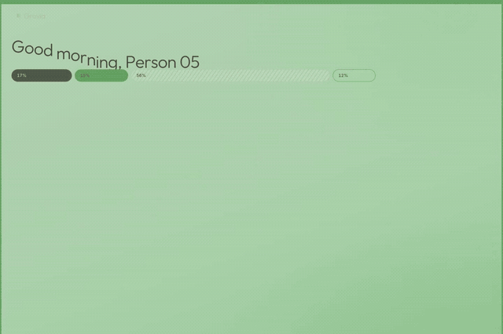
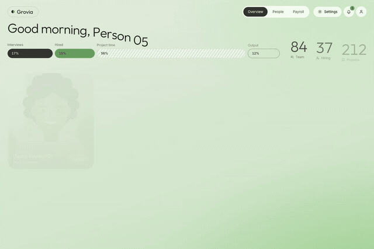
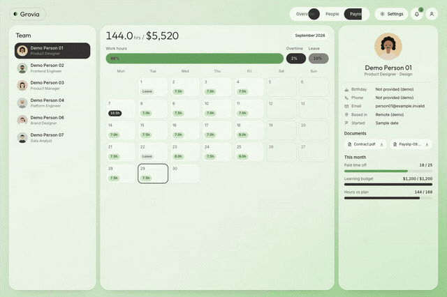
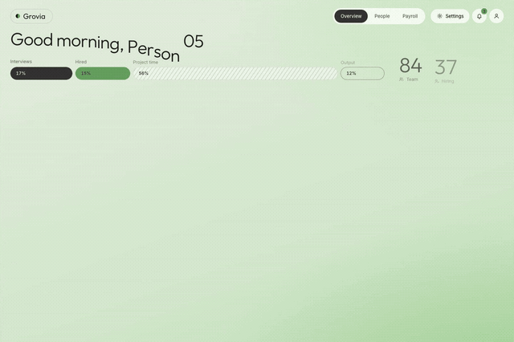

<div align="center">

<table>
  <tr>
    <td width="50%" align="center">
      
      <br />
      <sub><b>1. Overview Bento & Physics</b> — Cascading entrance, 3D tilt, SVG stopwatch, 14-particle burst</sub>
    </td>
    <td width="50%" align="center">
      
      <br />
      <sub><b>2. People Directory & GSAP Flip</b> — Category filter morphing, live search & bulk action tray</sub>
    </td>
  </tr>
  <tr>
    <td width="50%" align="center">
      
      <br />
      <sub><b>3. Payroll & Growth ROI Engine</b> — Staggered timesheet chips, PDF export & <code>/api/roi</code> model</sub>
    </td>
    <td width="50%" align="center">
      
      <br />
      <sub><b>4. Modals & Micro-Interactions</b> — Bell shake drawer, spring <code>&lt;dialog&gt;</code> & validation shake</sub>
    </td>
  </tr>
</table>

<p>
  <sub>View <a href="./public/showcase/grovia-2x2-showcase-30fps.gif">unified 2×2 30fps composite showcase GIF</a></sub>
</p>

# Grovia Motion — Fullstack SaaS & Workforce Platform

**Production fullstack workspace replicating Grovia's Bento design & GSAP 3.15 choreography, backed by Bun SQLite, Next.js 15 App Router, Zod APIs, CI/CD, and a 100/100 React Doctor score.**

[](https://grovia-motion-fullstack.netlify.app)
[](https://github.com/katsugtgz/grovia-app/actions/workflows/ci.yml)
[](https://react.doctor)
[](https://nextjs.org)
[](https://react.dev)
[](https://bun.sh)
[](https://gsap.com)
[](./LICENSE)

**[Live Netlify Deployment](https://grovia-motion-fullstack.netlify.app)** · **[Report Bug](https://github.com/katsugtgz/grovia-app/issues/new?template=bug_report.md)** · **[Request Feature](https://github.com/katsugtgz/grovia-app/issues/new?template=feature_request.md)** · **[Contributing](./CONTRIBUTING.md)**

</div>

---

## Highlights

- **Exact Grovia Aesthetic & Motion Choreography**: Warm sage-green Bento surfaces (`38px` / `28px` radii, inset white hairline elevation), Outfit & Inter typography, 31-glyph SVG sprite (`Icon.tsx`), sliding navigation pill with direction-aware `capL` / `mid` / `capR` GSAP delays, and a `1.6s` cascading entrance timeline.
- **Compositor-Only Physics & `prefers-reduced-motion` Safety**: All animations strictly animate GPU-composited `transform` and `opacity` properties via GSAP 3.15 (`Flip`, `quickTo`, `power3.out`, `back.out`, `elastic.out`) and automatically snap when `prefers-reduced-motion: reduce` is enabled.
- **Fullstack Next.js 15 Route Handlers + Bun SQLite (`WAL`)**: Real API persistence for waitlist signups, support inquiries/tickets, hiring pipeline metrics, and dynamic 12-month ROI modeling (`bun:sqlite` locally, with seamless in-memory serverless fallback on Netlify Node runtimes).
- **Google Chrome Modern Web Guidance Aligned**: LCP portrait prioritization (`priority`), non-blocking interactions (INP-friendly transitions), CLS containment, native `<dialog>` modals with ESC/backdrop closing, and semantic ARIA landmarks/tablists.
- **Zero-Defect Verification**: `235/235` passing tests (unit, contract, integration, and real-world scenarios), strict ESLint + TypeScript checks, automated GitHub Actions CI & Netlify CD, and **`100 / 100 Great`** on `npx react-doctor@latest`.

---

## Architecture & Views

| Surface / Module | Capabilities | Implementation |
| --- | --- | --- |
| **Overview Bento** | Animated split-text greeting, hiring pipeline rail (`17% / 15% / 56% / 12%`), live metrics counters, 3D parallax profile card, 7-day progress chart, SVG circular stopwatch (`6°/s`, 60 ticks, digit rollers), 14-particle onboarding checklist, accordion & week calendar, Growth & ROI calculator | [`components/views/OverviewView.tsx`](./components/views/OverviewView.tsx) |
| **People Directory** | Instant search across name/role/team, GSAP `Flip` animated team filter pills (`All`, `Design`, `Engineering`, `Product`, `Operations`), selectable table rows, procedural SVG avatars (`no()`), floating bulk action tray with CSV export | [`components/views/PeopleView.tsx`](./components/views/PeopleView.tsx) |
| **Payroll & PDF Export** | Keyboard-navigable teammate roster, 30-day PRNG timesheet matrix with staggered chip reveals, base + 1.5x overtime & deduction computation, pure client-side binary PDF 1.4 contract & payslip generator | [`components/views/PayrollView.tsx`](./components/views/PayrollView.tsx) |
| **Modals & Tray** | Notification drawer with bell-shake trigger, Workspace Settings dialog (`localStorage` persisted), Invite Teammate dialog with field-shake validation, Demo Booking modal | [`components/modals/`](./components/modals/) |
| **Persistence Engine** | WAL-mode `bun:sqlite` schema (`waitlist`, `inquiries`) with unique indexes, transactional inserts, health probes, and serverless fallback | [`lib/db.ts`](./lib/db.ts) |

---

## REST API Endpoints

| Method | Endpoint | Description |
| --- | --- | --- |
| `GET` | [`/api/health`](https://grovia-motion-fullstack.netlify.app/api/health) | System status, Bun runtime version, uptime, and SQLite health check |
| `GET` | [`/api/metrics`](https://grovia-motion-fullstack.netlify.app/api/metrics) | Live team/waitlist count, hiring pipeline distribution, and benchmark quartile |
| `POST` | `/api/roi` | Zod-validated 12-month revenue projection & ROI multiple computation |
| `GET`, `POST` | [`/api/waitlist`](https://grovia-motion-fullstack.netlify.app/api/waitlist) | List waitlist entries or book spot with case-insensitive deduplication (`409`) |
| `GET`, `POST`, `PATCH` | [`/api/inquiries`](https://grovia-motion-fullstack.netlify.app/api/inquiries) | Create & manage support tickets (`GROV-XXXX`) with status transitions |

<details>
<summary>Quick API verification with <code>curl</code></summary>

```bash
# Health probe
curl -s https://grovia-motion-fullstack.netlify.app/api/health

# Live ROI forecast
curl -s -X POST https://grovia-motion-fullstack.netlify.app/api/roi \
  -H "Content-Type: application/json" \
  -d '{"monthlyTraffic":100000,"conversionRate":3,"averageOrderValue":120}'
```

</details>

---

## Quickstart (Local Development)

> **Tooling policy:** This repository uses **Bun** exclusively for package management (`bun.lock` only) and **`rg`** (ripgrep) for search.

```bash
# 1. Clone repository
git clone https://github.com/katsugtgz/grovia-app.git
cd grovia-app

# 2. Install dependencies strictly via Bun
bun install --frozen-lockfile

# 3. Run development server
bun run dev
```

Open [http://localhost:3000](http://localhost:3000) to explore the interactive workspace locally backed by `grovia.db` (`bun:sqlite`).

### Scripts & Quality Gates

| Command | Purpose |
| --- | --- |
| `bun run dev` | Start Next.js 15 development server |
| `bun run build` | Production Next.js build |
| `bun run lint` | Run ESLint (`next lint`) |
| `bun run typecheck` | Strict TypeScript type checking (`tsc --noEmit`) |
| `bun test` | Run all 235 tests across 28 suites (unit, E2E tiers 1–4) |
| `bun run doctor` | Execute `npx react-doctor@latest` (enforces `100 / 100` score) |
| `bun run validate` | Full validation pipeline (`lint && typecheck && test && build && doctor`) |

---

## CI/CD & Repository Governance

- **Continuous Integration ([`.github/workflows/ci.yml`](./.github/workflows/ci.yml))**: Runs on every push and PR to `main`: `bun install --frozen-lockfile` → `bun run lint` → `bun run typecheck` → `bun test` → `bun run build` → `npx react-doctor@latest --score` (`100`).
- **Continuous Deployment ([`.github/workflows/cd.yml`](./.github/workflows/cd.yml))**: Automatically builds and deploys `main` to [Netlify Production](https://grovia-motion-fullstack.netlify.app) via `bunx netlify-cli deploy --prod`.
- **Branch Protection**: `main` requires passing `test` status check, up-to-date branches, conversation resolution, pull request review, and disallows force-pushes or branch deletion.
- **Security & Community**: Equipped with [`LICENSE`](./LICENSE) (MIT), [`CONTRIBUTING.md`](./CONTRIBUTING.md), [`CODE_OF_CONDUCT.md`](./CODE_OF_CONDUCT.md), [`SECURITY.md`](./SECURITY.md), [`CHANGELOG.md`](./CHANGELOG.md), Dependabot updates, and PR/Issue templates.

---

## License

Released under the [MIT License](./LICENSE).
